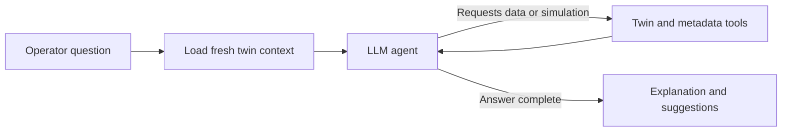

# Twin Manufacturing Copilot

## Step 1: Load Dataset

The official AI4I 2020 Predictive Maintenance dataset has been downloaded to:

`data/raw/ai4i2020.csv`

Run the dataset loader:

```bash
python3 src/prediction/load_data.py
```

This step checks:

- dataset shape
- column names
- data types
- missing values
- duplicate rows
- target distribution for `Machine failure`

Dataset source: UCI Machine Learning Repository, AI4I 2020 Predictive Maintenance Dataset, DOI `10.24432/C5HS5C`.

## Step 2: Remove ID and Leakage Columns

Create the model input dataset:

```bash
.venv/bin/python src/prediction/preprocess_data.py
```

This removes:

- ID columns: `UDI`, `Product ID`
- leakage columns: `TWF`, `HDF`, `PWF`, `OSF`, `RNF`

It also renames the remaining columns:

- `Type` -> `product_quality` (L: low, M: medium, H: high)
- `Air temperature [K]` -> `air_temperature_k`
- `Process temperature [K]` -> `process_temperature_k`
- `Rotational speed [rpm]` -> `rotational_speed_rpm`
- `Torque [Nm]` -> `torque_nm`
- `Tool wear [min]` -> `tool_wear_min`
- `Machine failure` -> `machine_failure`

The processed dataset is saved to:

`data/processed/model_input.csv`

## Step 3: Exploratory Data Analysis

Install dependencies into the project environment and generate the charts:

```bash
.venv/bin/python -m pip install -r requirements.txt
.venv/bin/python src/prediction/eda.py
```

Four figures are exported to `reports/figures` as 3200 x 1800 PNGs (16:9)
and matching PDFs:

- `01_target_class_distribution`: counts and percentages for the two target classes.
- `02_failure_rate_by_product_quality`: failure rates with counts and overall baseline.
- `03_numeric_features_by_failure`: five feature boxplots with outliers retained.
- `04_torque_vs_rpm_by_failure`: all observations colored by failure status.

Supporting statistics are saved in `reports/tables`. Slide takeaways are in
`reports/eda_slide_notes.md`. These charts describe the full synthetic dataset.
The quality encoder uses the predefined L/M/H schema and learns no statistics
from data. Fit any learned encoding, scaling, or resampling on training data only.

## Step 4: Feature Engineering

Create the model-ready feature table:

```bash
.venv/bin/python src/prediction/feature_engineering.py
```

This starts from `data/processed/model_input.csv` and creates leakage-safe,
target-independent features:

In the formulas below, `Tp` and `Ta` are process and air temperatures (K),
`n` is rotational speed (rpm), `t` is torque (Nm), and `w` is tool wear (min).

| Feature | Formula | Brief meaning |
| --- | --- | --- |
| `temperature_difference_k` | `Tp - Ta` | Temperature gap between process and air. |
| `temperature_ratio` | `Tp / Ta` | Process temperature relative to air temperature. |
| `mechanical_power_kw` | `P = t * (2 * pi * n / 60) / 1000` | Power in kW; converts rpm to rad/s and watts to kW. |
| `torque_per_krpm` | `t / (n / 1000)` | Torque relative to speed in thousands of rpm. |
| `tool_wear_x_torque` | `w * t` | Interaction between tool wear and load. |
| `tool_wear_x_power` | `w * P` | Interaction between tool wear and power. |
| `product_quality_L`, `product_quality_M`, `product_quality_H` | `1` if quality matches the column, otherwise `0` | One-hot encoding of product quality. |

The encoding order is L, M, H: L becomes `(1, 0, 0)`, M `(0, 1, 0)`,
and H `(0, 0, 1)`. All three columns are retained even if an input batch lacks
a category. The shared predictor builder rejects unknown quality levels and
uses this same encoding for training, Digital Twin prediction, and simulation.

The engineered dataset is saved to:

`data/processed/model_features.csv`

A feature dictionary is saved to:

`reports/tables/feature_dictionary.csv`

Scaling, imputation learned from data, feature selection, and resampling should
still be fit inside the training pipeline only.

## Step 5: Training and Test Split

Install dependencies and split the engineered dataset:

```bash
.venv/bin/python -m pip install -r requirements.txt
.venv/bin/python src/prediction/split_data.py
```

Uses an 80% training / 20% test split, stratified by `machine_failure`, with
`random_state=42` for reproducibility. Outputs contain all 14 feature columns
and the target:

- `data/processed/train.csv`: 8,000 rows for training.
- `data/processed/test.csv`: 2,000 rows for final evaluation.

When training, use `X = df.drop(columns=["machine_failure"])` and
`y = df["machine_failure"]`. Fit scaling and any resampling on training data
only. Use validation within the training set for model and threshold tuning;
reserve the test set for final evaluation.

## Step 6: Train and Compare Two Models

Train Random Forest first, then XGBoost on the same saved split:

```bash
.venv/bin/python -m pip install -r requirements.txt
.venv/bin/python src/prediction/train_model.py random_forest
.venv/bin/python src/prediction/train_model.py xgboost
```

On macOS, XGBoost also requires the OpenMP runtime: `brew install libomp`.

Random Forest uses `class_weight="balanced"`. XGBoost uses
`scale_pos_weight = training normal cases / training failure cases`
(`7729 / 271`, approximately `28.52`). Weights are applied during training.
Neither model requires scaling; the original class counts are preserved.

Both baselines use seed `42`, 300 trees, and a fixed classification threshold
of `0.5`. XGBoost uses depth `4`, learning rate `0.05`, row/column sampling
of `0.8`, and histogram tree construction. These settings are fixed before
test evaluation; model and threshold tuning should use training validation.

Saved outputs:

- `models/random_forest.joblib` and `models/xgboost.joblib`: trained estimators.
- `models/*_metadata.json`: feature order, parameters, versions, and test metrics.
- `reports/tables/model_comparison.csv`: accuracy, precision, recall, F1,
  ROC-AUC, average precision (a precision-recall summary), and confusion counts.
- `reports/tables/*_feature_importance.csv`: feature importance for each model.

Load an estimator with `joblib.load()` and supply the 14 engineered features
in the order recorded in its metadata. `predict_proba()` returns model scores;
calibration should be assessed before interpreting these as reliable failure
probabilities in the Digital Twin.

Export the test confusion matrices as 1600 x 1400 PNGs:

```bash
.venv/bin/python src/prediction/plot_confusion_matrices.py
```

Outputs: `reports/figures/random_forest_confusion_matrix.png` and
`reports/figures/xgboost_confusion_matrix.png`. Rows represent actual classes;
columns represent predictions. Cells show counts and percentages within each
actual class; colors also use these row percentages. Failure recall is
`TP / (TP + FN)` and appears beneath each matrix.

Export a side-by-side metric comparison as a 3200 x 1800 PNG:

```bash
.venv/bin/python src/prediction/plot_model_comparison.py
```

Output: `reports/figures/model_comparison.png`. Compares accuracy, precision,
recall, F1, ROC-AUC, and average precision using the saved test results.
Random Forest is marked as the selected model for future use.

## Step 7: Digital Twin

The Python Digital Twin loads the selected Random Forest once and maintains
one machine's current inputs, prediction, risk score, health indicator, and
UTC evaluation timestamp. It reuses the training feature formulas and one-hot
encoding without requiring a failure label at inference time.

Run the demonstration from the project root:

```bash
.venv/bin/python -m src.digital_twin.demo
```

The demonstration saves the original and what-if snapshots to
`reports/digital_twin_demo.json`. To use the twin in Python:

```python
from src.digital_twin import DigitalTwin, MachineState

twin = DigitalTwin(MachineState(
    product_quality="M",
    air_temperature_k=298.1,
    process_temperature_k=308.6,
    rotational_speed_rpm=1551,
    torque_nm=42.8,
    tool_wear_min=0,
))

prediction = twin.PredictFailure()
health = twin.CalculateHealth()
snapshot = twin.UpdateState(tool_wear_min=100)
comparison = twin.Simulate(rotational_speed_rpm=1200, torque_nm=60)
result = comparison.to_dict()
```

`UpdateState()` accepts complete inputs initially and partial updates afterward.
Invalid updates leave the current snapshot intact. Snapshots are immutable;
`Simulate()` evaluates a separate scenario and preserves the original state.
Temperatures and RPM must be positive; torque and wear must be nonnegative.
Product quality must be `L`, `M`, or `H`, and numeric inputs must be finite.

Output definitions:

- `machine_failure`: 0 or 1 using the saved threshold of 0.5.
- `failure_model_score`: the model's failure-class score between 0 and 1.
- `risk_score`: `100 * failure_model_score`, on a 0-100 scale.
- `health_indicator`: `100 - risk_score`, a heuristic inverse-risk indicator.
- `risk_score_change`: scenario risk minus baseline risk, in score points.

The weighted model's scores are uncalibrated, and the health indicator is not
a measured condition or remaining-life estimate. Simulation compares model
responses to changed inputs; it does not establish physical effects or predict
failure within a specified future time. The course twin is a virtual state
model, ready to connect to a dashboard and Copilot.

Verify the shared feature pipeline and twin state behavior:

```bash
.venv/bin/python -m unittest discover -s tests -v
```

## Step 8: Streamlit Web App

Run from the project root:

```bash
.venv/bin/python -m pip install -r requirements.txt
.venv/bin/python -m streamlit run app.py --server.address 127.0.0.1 --server.port 8501
```

Open `http://127.0.0.1:8501`. The app has four tabs:

- Machine state: enter all six inputs and predict with the selected Random Forest.
- What-if simulation: compare modified inputs with the evaluated original state.
- Model results: inspect the saved Random Forest and XGBoost test metrics and chart.
- Copilot: ask questions using the evaluated machine state and model tools.

Each browser session has its own Digital Twin. Updating the original state clears
the previous scenario and initializes new scenario inputs from the new baseline.
Reset clears the session and restores default input values. JSON downloads contain
the evaluated inputs and corresponding outputs; they do not overwrite the demo
report. Risk and health retain the definitions and limitations described above.

## Step 9: LangGraph Copilot

The Copilot uses Python, LangGraph `StateGraph` and `ToolNode`, and
`langchain-openai` with the OpenAI Responses API. The default LLM is
`gpt-4.1-mini`; set `OPENAI_MODEL` or change the model in the Copilot's Connection
settings to use another tool-capable OpenAI model available to your API account.
The LLM explains results; the existing Random Forest still calculates machine risk.

Install the dependencies using the command in Step 8, then provide an OpenAI API
key through the password field in Connection, the `OPENAI_API_KEY` environment
variable, or Streamlit secrets (`.streamlit/secrets.toml`):

```toml
OPENAI_API_KEY = "your-api-key"
```

After cloning the repository, create your local secrets file from the example
(skip this command if you already have a local secrets file):

```bash
cp .streamlit/secrets.toml.example .streamlit/secrets.toml
```

Enter your own API key in `.streamlit/secrets.toml`, then start or restart
Streamlit. The example file can be committed; `.streamlit/secrets.toml` is
excluded by `.gitignore` so your real key stays local.

Keep API keys out of source control. OpenAI API usage requires API billing.
The operator's questions, evaluated machine state, conversation context, and
requested tool results are sent to OpenAI when asking the Copilot. Prediction
and manual simulation work locally without an API key.

Evaluate the machine in Machine state, then open Copilot and try:

- "Explain the current risk and suggest what to inspect."
- "What if I replace the tool?"
- "Compare 1200 rpm and 60 Nm with the current readings."
- "What changed between the recorded readings?"
- "How many failures did Random Forest miss on the test set?"

Each question runs this graph:



Tools read the current state and existing prediction, the latest dashboard
comparison, saved model metrics, and up to 20 evaluated readings recorded in the
current browser session. The simulation tool validates explicit input changes
and calls `DigitalTwin.Simulate()` without updating the baseline. Successful
Copilot comparisons also appear in What-if simulation. Ordinary risk questions
reuse the existing prediction rather than triggering new Random Forest inference.

Evidence can be expanded under each answer, and conversations can be downloaded
as JSON. Each session keeps its own agent and the last 10 complete conversation
turns for follow-ups. Clear chat resets conversational memory while preserving
machine history. Reset clears the twin, history, connection fields, and chat.
History and conversation are held in memory, not persisted across server restarts.

The agent limits tool rounds and API timeouts, returns validation errors to the
LLM, and preserves successful conversation memory when a request fails. Its
instructions distinguish uncalibrated risk scores from failure probabilities
and scenario sensitivity from causal explanations. SHAP, live sensors,
maintenance manuals, and automatic machine control are not implemented.

Run the graph, twin, and dashboard tests without an API key:

```bash
.venv/bin/python -m unittest discover -s tests -v
```

The Copilot tests use scripted LLM messages with the real graph and Random Forest;
they do not evaluate the quality of responses from a live LLM.

## Copilot Research Evaluation

A separate benchmark provides 60 frozen evaluation tasks and 12 development tasks,
with machine states, independently computed twin reference results, expected tool
behavior, and human-review criteria. It covers current-state explanations, what-if
simulation, history and follow-ups, saved model metrics, ambiguous/invalid inputs,
and unsupported claims.

See [the evaluation protocol](evaluation/copilot_v1/README.md) and browse
[the scenarios](evaluation/copilot_v1/scenarios.csv). Validate the references
without an API key:

```bash
.venv/bin/python -m src.evaluation.run --split evaluation --dry-run
```

The live runner records actual Copilot answers, tool evidence, objective checks,
and forms for two human reviewers. Objective checks alone do not establish answer
quality or complete task success. Use development cases for tuning and preserve
the final evaluation split for reporting.
