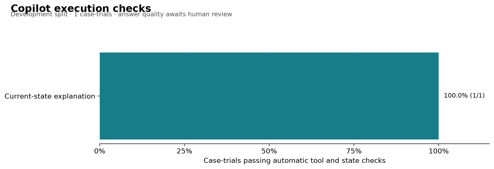

# Copilot evaluation results

**Status: Complete trial recording.**

Model requested: `gpt-4.1-mini`. Split: **development**. Started: 2026-10-17T17:33:07.809405+00:00.
Recorded **1 / 1 case-trials**, **1 conversation turns**, and **0 execution errors**.

These rates measure tool execution, arguments, fresh state, and baseline preservation. They do not establish answer correctness, explanation quality, or absence of unsupported claims.

| Category | Trials | Passed automatic checks | Pass rate | Errors | Mean answer time |
| --- | ---: | ---: | ---: | ---: | ---: |
| Current-state explanation | 1 | 1 | 100.00% | 0 | 4.30 s |

Overall automatic check rate: **1/1 (100.00%)**.

**Human-evaluated task success: pending.** Have reviewers A and B independently complete `human_reviews.csv`, then document any adjudication. Do not report the automatic rate as overall Copilot accuracy.

Errors count as failed trials; connection failures describe the test setup and do not establish the Copilot's reasoning quality. Mean answer time includes only completed turns and excludes agent initialization. The execution-error count is per recorded turn; a failed warm-up ends its task-trial.

This report covers only the selected split and tasks. A development smoke test is not the 60-task final benchmark. Full research results should additionally report repeated-trial reliability and uncertainty after human grading.

The chart is generated from recorded trials. Full evidence is in `trials.jsonl`; run configuration is in `manifest.json`.
