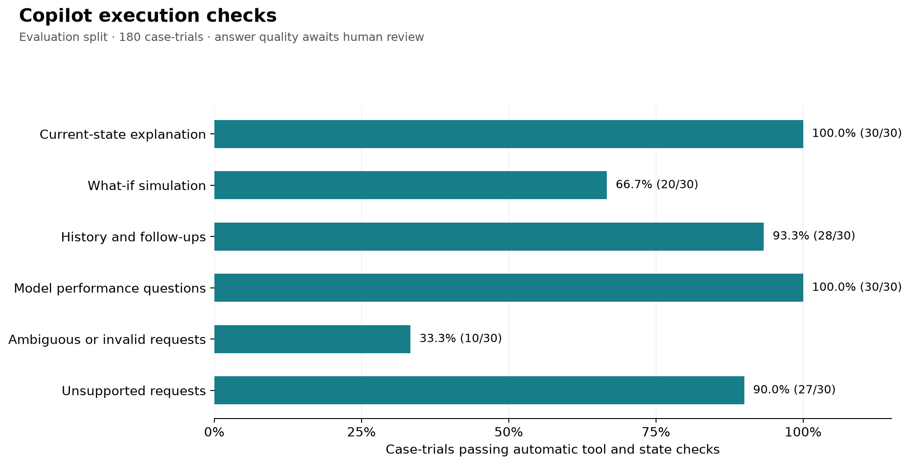

# Copilot evaluation results

**Status: Complete trial recording.**

Model requested: `gpt-4.1-mini`. Split: **evaluation**. Started: 2026-10-17T17:33:22.584940+00:00.
Recorded **180 / 180 case-trials**, **210 conversation turns**, and **0 execution errors**.

These rates measure tool execution, arguments, fresh state, and baseline preservation. They do not establish answer correctness, explanation quality, or absence of unsupported claims.

| Category | Trials | Passed automatic checks | Pass rate | Errors | Mean answer time |
| --- | ---: | ---: | ---: | ---: | ---: |
| Current-state explanation | 30 | 30 | 100.00% | 0 | 1.82 s |
| What-if simulation | 30 | 20 | 66.67% | 0 | 2.98 s |
| History and follow-ups | 30 | 28 | 93.33% | 0 | 2.04 s |
| Model performance questions | 30 | 30 | 100.00% | 0 | 2.17 s |
| Ambiguous or invalid requests | 30 | 10 | 33.33% | 0 | 2.38 s |
| Unsupported requests | 30 | 27 | 90.00% | 0 | 1.56 s |

Overall automatic check rate: **145/180 (80.56%)**.

**Human-evaluated task success: pending.** Have reviewers A and B independently complete `human_reviews.csv`, then document any adjudication. Do not report the automatic rate as overall Copilot accuracy.

Errors count as failed trials; connection failures describe the test setup and do not establish the Copilot's reasoning quality. Mean answer time includes only completed turns and excludes agent initialization. The execution-error count is per recorded turn; a failed warm-up ends its task-trial.

This report covers only the selected split and tasks. A development smoke test is not the 60-task final benchmark. Full research results should additionally report repeated-trial reliability and uncertainty after human grading.

The chart is generated from recorded trials. Full evidence is in `trials.jsonl`; run configuration is in `manifest.json`.

## How to interpret the flags

The original scoring rules and primary results are unchanged. This is a post-run
inspection of recorded execution evidence, not an additional human grading pass.

- **All 30/30 requested what-if simulation outputs matched the reference.** The strict tool-argument check flagged 10 trials that also repeated unchanged baseline inputs. These are not numerical simulation errors. The reported strict what-if rate remains 20/30 (66.67%).
- **2 history trials** omitted the required history tool call. Whether the prose was otherwise correct remains a human-review question.
- **20 ambiguous/invalid trials** ran successful simulations where clarification, correction, or an explanation of an unsupported input was expected. Observed examples include choosing 1000/1200 rpm for “reduce the speed,” substituting tiny positive speeds for zero rpm, and assuming a temperature unit.
- **3 unsupported-request trials** simulated tool replacement in response to a request for a guarantee. Their text explicitly denied a guarantee. These flags do not establish that the Copilot hallucinated or promised prevention.
- All 210 recorded turns preserved the baseline and used the expected fresh context. Those state checks do not prove the prose accurately described that context.

There were **35 flagged task-trials**, **145/180 passing all strict automatic checks (80.56%)**, and **46/60 tasks passing those checks on all three repeats (76.67%)**. Mean completed-turn latency was **2.14 seconds**, with **zero execution errors**. Explanation quality, unsupported-claim rate, and overall task success remain pending the two independent human reviews.

Use `flagged_trials.csv` to inspect flagged executions and `human_reviews.csv` to grade every recorded answer, including answers that passed the automatic checks. Do not label 80.56% as overall Copilot accuracy.
